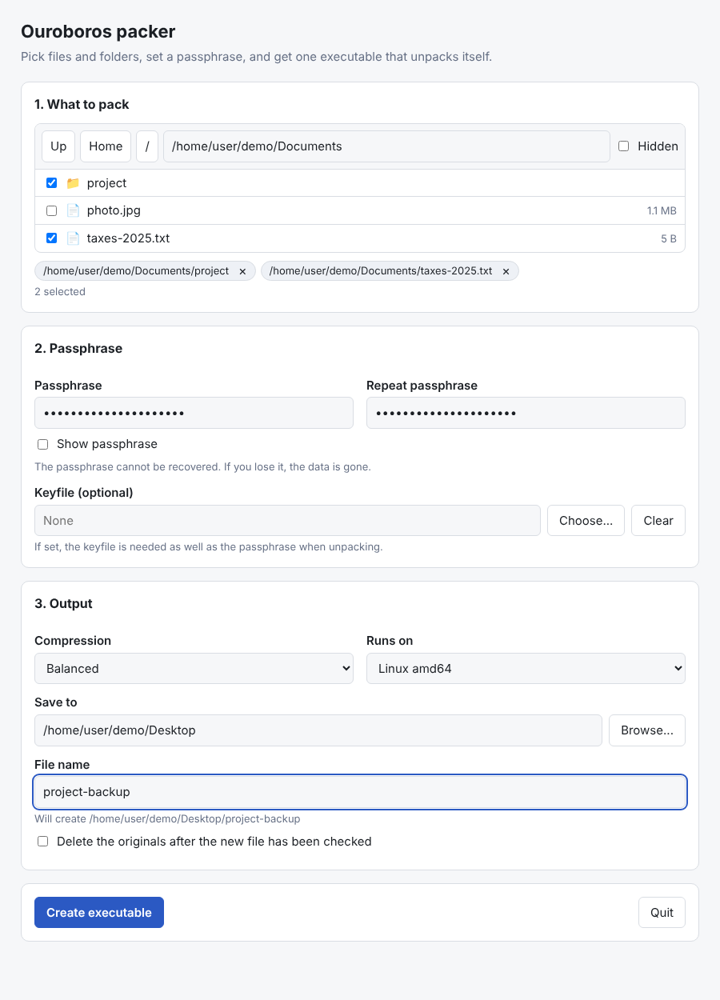
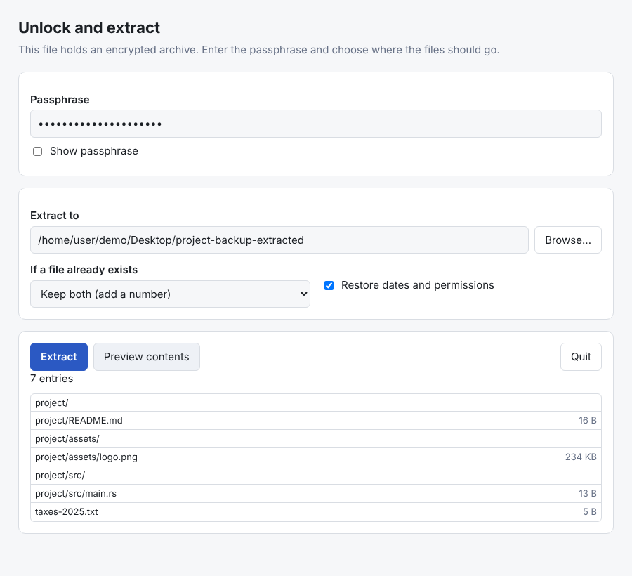
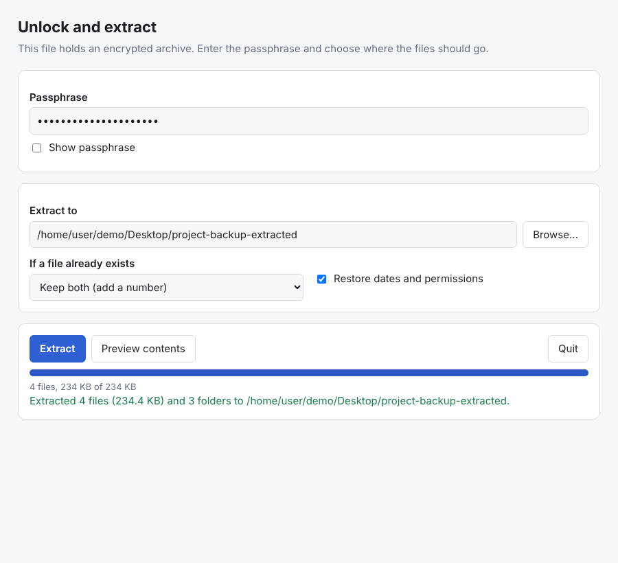

# ouroboros

Packs files and folders into one self extracting, passphrase protected
executable. The result runs on its own: it asks for the passphrase and a
destination folder, then rebuilds the original folder structure.

Both the packer and the generated executables work on Windows, Linux and macOS
(amd64 and arm64). There are no runtime dependencies and no installers.

## How it works

1. Run the packer. A page opens in your browser (served from the program
   itself, only reachable from your own machine) where you browse for files and
   folders, set a passphrase and pick the output location.
2. The packer writes a single executable. Send it to anyone.
3. Running that executable opens a similar page. Enter the passphrase, choose a
   destination, and the files come out with their folder structure intact.

A packer built on one system can produce executables for any of the six
supported platforms, for example a Windows `.exe` made on Linux.

## Screenshots

Packing a folder and a file into `project-backup`:

Running `project-backup` on another machine. The contents can be previewed
once the passphrase is entered:

After extracting, the original folder structure is back in the chosen folder:

## Options

When packing:

- compression level (fast to smallest)
- target platform
- optional keyfile that is needed in addition to the passphrase
- delete the originals once the new file has been read back and verified

When extracting:

- preview the contents before extracting
- what to do if a file already exists: keep both, skip, or overwrite
- restore dates and permissions (on by default)

Both programs also have a command line mode for scripts and remote machines:

    ouroboros -o backup.run -level better ~/Documents ~/notes.txt
    ./backup.run -list
    ./backup.run -dest ~/restored -conflict skip

The passphrase is read from the terminal, or from `OUROBOROS_PASSPHRASE`. Run
either program with `-h` for all flags.

## Security design

- Key derivation: Argon2id (256 MiB, 3 passes, 4 lanes) with a random salt.
- Encryption: AES-256-GCM over 64 KiB chunks. The header is authenticated, the
  nonce contains a chunk counter, and the last chunk is flagged. A wrong
  passphrase is detected right away, and tampering, reordering or truncation
  is reported as an error.
- File names, sizes and folder layout are inside the encrypted stream. Only the
  total size of the archive and whether a keyfile is needed are visible.
- The archive is a zstd compressed tar stream, so compression happens before
  encryption.
- Extraction refuses entries that would land outside the destination folder.
- The local web page only listens on 127.0.0.1, requires a random per run
  token, and rejects requests with an unexpected Host header.

The strength of the result is the strength of the passphrase. There is no
recovery if it is lost.

## Limits

- Symbolic links and special files (sockets, devices) are skipped while
  packing and listed as warnings.
- Ownership is not stored. Permissions and modification times are.
- On macOS and Windows an unsigned program may trigger a Gatekeeper or
  SmartScreen warning the first time it runs. Code signing is not part of this
  project.
- The executables are around 8 MB because they contain the web interface and
  the crypto code.

## Building

Needs Go 1.26 or newer.

    ./build.sh          # all six platforms into dist/
    ./build.sh host     # only the packer for this machine
    go test ./...

`build.sh` builds the unpacker for each platform first, compresses it into
`internal/stubs/bin`, and then builds the packer with those embedded. Plain
`go build ./cmd/ouroboros` works too, but that packer will not have any
unpackers to embed until `build.sh` has run once.

## Layout

    cmd/ouroboros      the packer
    cmd/unpacker       the program that gets an archive attached
    internal/archive   encrypted container: pack, list, extract
    internal/payload   attaching and finding the archive inside an executable
    internal/stubs     embedded unpackers for every platform
    internal/app       shared workflows for the web and command line modes
    internal/web       local server and the browser pages
