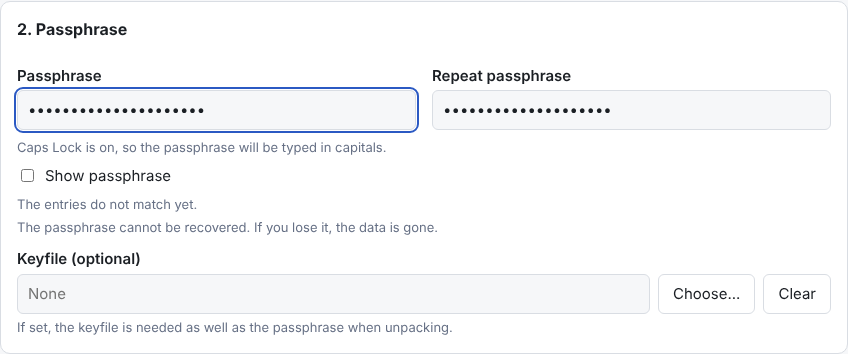
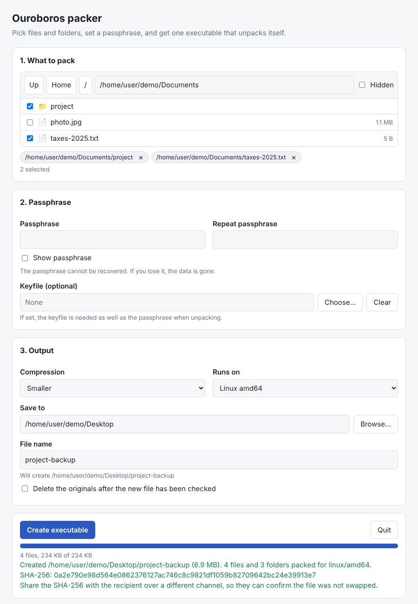

# ouroboros

Packs files and folders into one self extracting, passphrase protected
executable. The result runs on its own: it asks for the passphrase and a
destination folder, then rebuilds the original folder structure.

Both the packer and the generated executables work on Windows, Linux and macOS
(amd64 and arm64). There are no runtime dependencies and no installers.

## How it works

1. Run the packer. A page opens in your browser (served from the program
   itself on your own computer) where you browse for files and
   folders, set a passphrase and pick the output location. If no browser opens,
   copy the address the program prints. It works once.
2. The packer writes a single executable and shows its SHA-256. Send both to
   the recipient, the hash over a different channel than the file.
3. Running that executable opens a similar page. Enter the passphrase, choose a
   destination, and the files come out with their folder structure intact.

A packer built on one system can produce executables for any of the six
supported platforms, for example a Windows `.exe` made on Linux.

## Screenshots

Packing a folder and a file into `project-backup`. The passphrase section
checks that both entries match:

The passphrase fields warn about Caps Lock and mismatched entries while you
type:

When the file has been written and read back, the packer shows where it is and
its SHA-256, which is worth sharing with the recipient separately:

Running `project-backup` on another machine. The contents can be previewed once
the passphrase is entered:

After extracting, the original folder structure is back in the chosen folder:

## Options

When packing:

- compression level (fast to smallest)
- target platform
- optional keyfile that is needed in addition to the passphrase
- passphrase checks: a live match indicator for the repeat field, a warning for
  a leading or trailing space, and a Caps Lock warning (also when unpacking)
- delete the originals once the new file has been read back and verified (only
  what was stored, and never if anything was skipped)

When extracting:

- preview the contents before extracting
- what to do if a file already exists: keep both, skip, or overwrite
- restore dates and permissions (on by default)
- the passphrase field is cleared after a successful extract

Both programs also have a command line mode for scripts and remote machines:

    ouroboros -o backup.run -level better ~/Documents ~/notes.txt
    ./backup.run -list
    ./backup.run -dest ~/restored -conflict skip

The passphrase is read from the terminal, or from `OUROBOROS_PASSPHRASE`, which
is cleared once it has been read. Run either program with `-h` for all flags.

## Security design

- Key derivation: Argon2id (256 MiB, 3 passes, 4 lanes) with a random salt.
  An archive that asks for settings outside 64 to 512 MiB, 1 to 10 passes or
  1 to 16 lanes is refused before any work is done, so a crafted file cannot
  exhaust a machine.
- The passphrase is normalised (Unicode NFC) so the same text typed on macOS,
  Windows or Linux gives the same key.
- Encryption: AES-256-GCM over 64 KiB chunks. The header is authenticated, the
  nonce contains a chunk counter, and the last chunk is flagged. A wrong
  passphrase is detected right away, and tampering, reordering or truncation
  is reported as an error.
- File names, sizes and folder layout are inside the encrypted stream. Only the
  total size of the archive and whether a keyfile is needed are visible.
- The archive is a zstd compressed tar stream, so compression happens before
  encryption.
- Extraction is confined to the destination folder with Go's `os.Root`. Names
  with `..`, absolute paths and Windows drive or device names are refused, and
  links that already sit in the destination are never followed, even in
  overwrite mode. Setuid and setgid bits are never restored. A failed run does
  not leave a truncated file behind.
- Delete originals is cautious. It only runs after the new file has been read
  back completely, it removes only the files that were stored and still match
  what was packed, it removes folders only when they are empty, and it does
  nothing at all if anything was skipped (for example a symbolic link).
- The packer refuses to save its output inside a folder it is packing, also
  through links and on case insensitive systems, and refuses a keyfile that is
  inside the packed folders.
- Names shown to you from an archive have control and direction characters
  escaped.

### How the local page is protected

The page is served by the program itself on `127.0.0.1` with a random port.
That keeps it off the network, but other user accounts on the same computer can
still connect to a loopback port, so the page defends itself:

- The address printed at startup contains a link token that works once. The
  first visit trades it for a session cookie (`HttpOnly`, `SameSite=Strict`)
  and redirects to a clean address, so the token does not stay in the browser
  history and a copy found in a process list is already dead.
- Every API call needs that cookie and a second token in a header, and the
  `Host` header must match, which stops other websites and DNS rebinding.
- Strict security headers are sent (no inline scripts, no framing, no
  referrer), and only four static files are served.
- The program closes itself after 30 minutes without use, and refuses to quit
  while a job is running.
- `OUROBOROS_PASSPHRASE` is cleared from the environment as soon as it has
  been read.

On a machine shared with people you do not trust, prefer the command line mode.

### What this does and does not protect against

Protects against:

- someone who gets the executable and does not know the passphrase,
- accidental or malicious changes to the file (they are detected),
- a malicious archive trying to write outside the folder you chose.

Does not protect against:

- **A swapped program.** The recipient runs an executable and types the
  passphrase into it. Nothing signs that executable, so someone who replaces
  it in transit can capture the passphrase, and a fake file that merely looks
  like one of ours is a good lure. Only run files from people you trust, and
  compare the SHA-256 that the packer shows with the sender over a different
  channel (a call, a message app).
- **A compromised computer** on either end.
- **A weak passphrase.** The archive can be attacked offline, and Argon2 only
  slows that down. There is no recovery if the passphrase is lost.
- **Size analysis.** The total size of the archive is visible.
- **Memory inspection.** Go cannot wipe the passphrase from memory, and it may
  reach swap.
- **An archive that expands enormously.** Entry counts and the decompression
  window are capped, but total extracted size is not, so pick a destination
  with enough free space. Check the preview first.
- **Unwanted names.** An archive can contain names like `.bashrc` or
  `.ssh/authorized_keys`. Extract into an empty folder, not your home folder.

## Building

Needs Go 1.26 or newer.

    ./build.sh          # all six platforms into dist/
    ./build.sh host     # only the packer for this machine
    go test ./...

`build.sh` builds the unpacker for each platform first, compresses it into
`internal/stubs/bin`, and then builds the packer with those embedded. Plain
`go build ./cmd/ouroboros` works too, but that packer will not have any
unpackers to embed until `build.sh` has run once.

Builds are reproducible: the same commit and Go version give identical bytes.
`build.sh` also writes a checksum list for the embedded unpackers, and the
packer refuses to use one that does not match it.

## Releases

The `release` workflow builds the downloads: a `.tar.gz` for Linux, a `.zip`
for Windows, and a `.dmg` for macOS holding a universal (Intel and Apple
silicon) binary. Run it from the Actions tab, or push a tag like `v0.1.0` to
publish the files on a GitHub release together with `SHA256SUMS` and a GitHub
build attestation.

### Verifying a download

    sha256sum -c SHA256SUMS --ignore-missing
    gh attestation verify ouroboros-linux-amd64.tar.gz --repo mattlalumiere/ouroboros

### Code signing

The programs are **not code signed yet**, so the operating systems will warn
the first time you run them. Check the checksum first, then:

- **Windows:** SmartScreen shows "Windows protected your PC". Choose "More
  info", then "Run anyway".
- **macOS:** try to open it once, then open System Settings, Privacy &
  Security, and choose "Open Anyway" next to the message about the program.
  (Control-click, Open no longer works on current macOS versions.) From a
  terminal, `xattr -d com.apple.quarantine <file>` does the same.
- **Linux:** no warning, but the file needs to be executable: `chmod +x <file>`.

Files created by the packer are made on your own computer, so they cannot carry
the project's signature, and they will show the same warnings on a recipient's
Windows or macOS machine. Attaching the archive also changes the file, which
would invalidate a Windows signature that was applied to the unpacker beforehand.
Signing the finished file with your own certificate is the way around that.

## Limits

- Symbolic links and special files (sockets, devices) are skipped while
  packing and listed as warnings.
- Ownership is not stored. Permissions and modification times are.
- The executables are around 8 MB because they contain the web interface and
  the crypto code.
- The archive has to stay at the very end of the file, so a signature cannot
  be added after the fact by tools that append to the file.

## Roadmap

Planned work, including code signing and public key signing, is in
[TODO.md](TODO.md).

## License

MIT, see [LICENSE](LICENSE). The programs include code from a few other
modules, whose licenses are in [THIRD_PARTY_LICENSES.md](THIRD_PARTY_LICENSES.md).

## Layout

    cmd/ouroboros      the packer
    cmd/unpacker       the program that gets an archive attached
    internal/archive   encrypted container: pack, list, extract
    internal/payload   attaching and finding the archive inside an executable
    internal/stubs     embedded unpackers for every platform
    internal/app       shared workflows for the web and command line modes
    internal/web       local server and the browser pages
    docs/screenshots   images used in this file
